  
  
  
  
  
  
  
  

<table>
<tr>
<td width="33%" valign="top">

**Quantum ML security** 
Backdoor detection, explanation and repair in hybrid quantum neural networks — the subject of my M.Sc. thesis, QMedShield.

</td>
<td width="33%" valign="top">

**Explainable & medical AI** 
Interpretable models for high-stakes prediction: diabetes risk, industrial machinery failure, fake news, and medical imaging.

</td>
<td width="33%" valign="top">

**Robotics & IoT** 
A life-size 3D-printed humanoid, live campus bus tracking, and IoT devices for monitoring and energy harvesting.

</td>
</tr>
</table>

## Research

My research focuses on backdoor detection and defense in hybrid quantum neural networks — models that combine parameterized quantum circuits with classical deep learning and are increasingly studied for medical imaging. A backdoored model that misclassifies a medical image on cue is a quiet and serious failure, so my M.Sc. thesis, QMedShield, builds a quantum measurement-guided framework that detects, explains and repairs backdoor attacks in multiclass medical hybrid QNNs. The work sits at the intersection of quantum machine learning, AI security, and medical imaging. Supervisor: Dr. Dulal Chakraborty, Comilla University.

### Publications

Newest first. Journal and conference papers; my name in bold.

- K. M. **Tousif Bin Parves**, Md. Mohiuddin Khan Mahin, Jahid Karim Fahim, Akash Hasnat, Shahjalal Khan, and Alimul Rajee 
  **CrossEcomPack: Cross-Domain Package Localization for Low-Resource E-Commerce Logistics** 
  3rd International Conference on Machine Intelligence and Emerging Technologies (MIET 2026), Noakhali Science and Technology University, Bangladesh · presented, October 2026 · first author
- K.M.T.B. **Parves** and P.K. Shill 
  **Explainable Stacked Ensemble Learning for Fake News Detection using Text and Metadata** 
  Jurnal The Messenger, vol. 18, no. 1, pp. 120–136, 2026 · Web of Science indexed 
- **Occupancy-Aware Smart Stair Lighting Using Finite-State Control and Piezoelectric Energy Harvesting** 
  3rd International Conference on Sustainable Development through Excellence in Higher Education (ICSDEHE 2026) · accepted for presentation · corresponding author
- **Explainable Machine Learning for Industrial Machinery Failure Detection: A Comparative Study of Classification Performance and Sensor Feature Attribution** 
  SSIM 2026, Track 7: Computational Social Sciences and Advanced Data Analytics · accepted for presentation
- **Garbage Monitoring System with Rewarding Mechanism Using IoT Devices Like ESP32, ESP32-CAM, RFID Module** 
  ICMRS 2026, Comilla University, Bangladesh · accepted · corresponding author
- S. Saiyed, M. Hasan, R. Chowdhury, K.M.T. **Bin Parves**, E. Hariyadi, and V. Kumar 
  **Harnessing Artificial Intelligence to Strengthen Green Innovation Capacity in Pursuit of Sustainable Development Goals: Evidence from Taiwan's Manufacturing Sector** 
  Equilibrium: Quarterly Journal of Economics and Economic Policy, vol. 20, no. 3, pp. 877–904, 2025 · SJR Q1 (Economics), ESCI indexed 
- A. Hasnat, M.T.M. Himel, M.R. Hasan, K.M.T.B. **Parves**, and M.S. Hasan 
  **Diabetes Prediction with Explainable AI: A Stacking Ensemble Approach for Better Accuracy and Interpretability** 
  2025 International Conference on Quantum Photonics, Artificial Intelligence, and Networking (QPAIN), pp. 1–6 
- **Academic Assistant: A Robotic System Powered by Retrieval-Augmented Generation and Fine-Tuned LLMs for Interactive Learning** 
  Manuscript under review, 2026 · supervised by Dr. Dulal Chakraborty, Comilla University

[Google Scholar](https://scholar.google.com/citations?user=N545a-3c6VUC&hl=en) · [ORCID](https://orcid.org/0009-0006-9309-879X) · [ResearchGate](https://www.researchgate.net/profile/Km-Tousif-Bin-Parves)

## Selected projects

<table>
<tr>
<td width="26%" valign="top"><b><a href="https://github.com/tousifo/ml_notebooks/blob/main/pimcl_new.ipynb">Prototype-Based QNN MIL</a></b> 2025 · QUANTUM ML RESEARCH · INDEPENDENT PROJECT</td>
<td valign="top">A hybrid quantum neural network multiple-instance learning model with contrastive loss for brain MRI analysis, built in PyTorch and PennyLane. Prototype-based instance classification grades dementia on the OASIS dataset. · <a href="https://github.com/tousifo/ml_notebooks/blob/main/pimcl_new.ipynb">Notebook</a></td>
</tr>
<tr>
<td width="26%" valign="top"><b><a href="https://github.com/tousifo/Robot-Niko">Robot Niko</a></b> 2022 · TEAM BUILD, CUMILLA · CO-DEVELOPER</td>
<td valign="top">A life-size 3D-printed humanoid assistant on a Raspberry Pi: 27 degrees of freedom, face recognition and wake-word speech. The body took about 11 months to print — more than 329 pieces — and the system design and build are documented in our technical report. · <a href="https://github.com/tousifo/Robot-Niko">Code</a> · <a href="https://doi.org/10.5281/zenodo.23719561">Report</a> · <a href="https://youtu.be/6iEj3AY1AlA">Video</a></td>
</tr>
<tr>
<td width="26%" valign="top"><b><a href="https://github.com/tousifo/academic_assistant">AI Academic Assistant</a></b> 2023 – 2024 · SUPERVISED RESEARCH, COMILLA UNIVERSITY · ONGOING</td>
<td valign="top">A voice-interactive academic Q&amp;A system that pairs a humanoid robot with a fine-tuned LLM and a Retrieval-Augmented Generation pipeline on a Raspberry Pi, aimed at culturally relevant, personalized learning. Development is ongoing, and a paper describing the system is under review. · <a href="https://github.com/tousifo/academic_assistant">Code</a></td>
</tr>
<tr>
<td width="26%" valign="top"><b><a href="https://github.com/tousifo/University-Bus-Tracking-System">University Bus Tracker</a></b> 2024 · CAMPUS IOT SYSTEM · TEAM DEVELOPER</td>
<td valign="top">Live GPS tracking for Comilla University's buses: ESP32-CAM units on board stream location and camera feeds to a Flask server with a real-time web dashboard, and occupancy is monitored with computer vision. Champion, Innovation Project Showcase 2024 (UGC and Comilla University). · <a href="https://github.com/tousifo/University-Bus-Tracking-System">Code</a></td>
</tr>
<tr>
<td width="26%" valign="top"><b>AI Inventory Management</b> 2023 · COMPUTER VISION</td>
<td valign="top">Real-time inventory management with YOLOv8 object detection, reaching 82% mAP on Daraz inventory data.</td>
</tr>
</table>

## Teaching

I teach across data structures, algorithms, database systems, web technologies, AI/ML, robotics, embedded systems, IoT, and research methodology at Port City International University. My course design follows Outcome-Based Education practice: course-outcome design, constructive alignment, learning activities, assessment, evaluation and feedback.

## Experience

<table>
<tr><th width="1%" align="left">When</th><th align="left">Role</th><th align="left">Where</th></tr>
<tr><td><code>Sep 2025 – now</code></td><td>Lecturer, Department of CSE</td><td>Port City International University, Chattogram</td></tr>
<tr><td><code>Jul 2023 – Aug 2025</code></td><td>Research Assistant, Quantum Machine Learning Lab</td><td>Department of ICT, Comilla University</td></tr>
<tr><td><code>2024 – 2025</code></td><td>Co-Founder</td><td>RoboICT</td></tr>
<tr><td><code>2022 – 2023</code></td><td>Robotics &amp; Programming Instructor, part-time</td><td>School of Robotics, Cumilla</td></tr>
</table>

## Education

<table>
<tr><th align="left">Degree</th><th align="left">Institution</th><th align="left">Years</th><th align="left">Thesis</th></tr>
<tr><td><b>M.Sc. (Engineering) in ICT</b></td><td>Comilla University</td><td><code>2025 – 2026</code></td><td>QMedShield — quantum measurement-guided backdoor detection and repair in medical hybrid QNNs</td></tr>
<tr><td><b>B.Sc. (Engineering) in ICT</b></td><td>Comilla University</td><td><code>2020 – 2025</code></td><td>—</td></tr>
</table>

## Honours & awards

<table>
<tr><th width="1%" align="left">Year</th><th align="left">Award</th></tr>
<tr><td><code>2024</code></td><td>Champion, Innovation Project Showcase — University Bus Tracker (UGC and Comilla University)</td></tr>
<tr><td><code>2024</code></td><td>Champion, Science Project Showcasing, 2nd CoUSC National Science Festival</td></tr>
<tr><td><code>2023</code></td><td>Runner-up, Line Follower Robot Competition, BAIUST EEE Day '23</td></tr>
<tr><td><code>2020 – 21</code></td><td>1st Runner-up, Hult Prize, Comilla University</td></tr>
<tr><td><code>2020 – 21</code></td><td>South-East Asia Region Finalist, Hult Prize</td></tr>
<tr><td><code>2020</code></td><td>Special Mention, NSTU National MUN — Delegate of Spain, International Energy Agency</td></tr>
<tr><td><code>2019</code></td><td>MetLife Foundation Pathways Scholarship</td></tr>
</table>

## Service & training

<table>
<tr>
<td width="50%" valign="top">

**Training** 
Outcome-Based Education (OBE) curriculum training — Port City International University, 2025 
Data Science, Machine Learning &amp; MLOps Bootcamp — Bongodev, 2023–24 
Quantum Computing with Machine Learning — Mahdy's Research Academy, 2024–25

</td>
<td width="50%" valign="top">

**Service** 
Co-organizer, TEDx CoU — 2023 
General Secretary, CoU IT Society — 2024–25 
President, Rotaract Club of Comilla Shining Star — 2024–25 
Co-Founder, RoboICT — 2024–25

</td>
</tr>
</table>

## Toolkit

<table>
<tr><th width="1%" align="left">Area</th><th align="left">Tools</th></tr>
<tr><td><b>Languages</b></td><td>Python, C++</td></tr>
<tr><td><b>ML &amp; vision</b></td><td>PyTorch, TensorFlow, scikit-learn, OpenCV</td></tr>
<tr><td><b>Quantum ML</b></td><td>PennyLane, Qiskit</td></tr>
<tr><td><b>LLMs &amp; RAG</b></td><td>LangChain, fine-tuned LLMs</td></tr>
<tr><td><b>Robotics &amp; IoT</b></td><td>ROS 2, Arduino, Raspberry Pi</td></tr>
<tr><td><b>Deployment &amp; tools</b></td><td>Docker, Flask, Linux, Git, Google Colab</td></tr>
</table>

Open to research collaboration in quantum ML security, explainable AI and robotics — write to me at tousifbnn@gmail.com.
