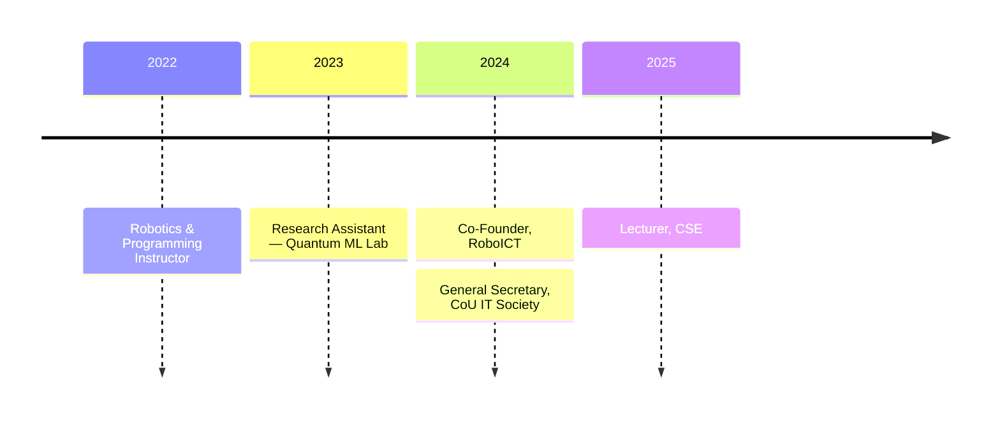

  

 

## ◆ About

I am a **Lecturer in Computer Science & Engineering** working where machine learning meets physical systems — from **quantum machine learning for medical imaging** to **3D-printed humanoid robots** and **AI-assisted education**.

My focus is turning research ideas into systems that actually run in the real world.

 

## ◆ Research Interests

<table>
<tr>
<td width="50%" valign="top">

**⚛️ Quantum Machine Learning** 
Hybrid quantum–classical models · multiple-instance learning for MRI

</td>
<td width="50%" valign="top">

**🧠 Machine Learning & Vision** 
Deep learning · computer vision · MLOps and deployment

</td>
</tr>
<tr>
<td width="50%" valign="top">

**🤖 Robotics & Embedded Systems** 
Humanoid platforms · autonomous navigation · human–robot interaction

</td>
<td width="50%" valign="top">

**📚 AI in Education** 
Retrieval-augmented generation · LLM-based academic assistants

</td>
</tr>
</table>

## ◆ Selected Projects

<table>
<tr>
<td width="50%" valign="top">

#### ⚛️ Prototype-Based QNN MIL
QUANTUM ML · MEDICAL IMAGING

Hybrid quantum neural network multiple-instance learning with contrastive loss for MRI analysis.

`PyTorch` `PennyLane` `QNN`

</td>
<td width="50%" valign="top">

#### 🤖 Robot NIKO
3D-PRINTED HUMANOID ROBOT

Autonomous navigation, human detection, and conversational interaction.

`ROS2` `Python` `Arduino` `Raspberry Pi` `RAG` `LLMs`

</td>
</tr>
<tr>
<td width="50%" valign="top">

#### 📚 AI Academic Assistant
RAG · FINE-TUNED LLM · ROBOT

Interactive academic Q&A combining a humanoid robot, a fine-tuned LLM, and a RAG pipeline on Raspberry Pi.

`Python` `LangChain` `LLMs` `RAG`

</td>
<td width="50%" valign="top">

#### 🚌 University Bus Tracker
🏆 CHAMPION · INNOVATION SHOWCASE 2024

GPS-based live bus tracking for real-world campus transportation.

`Python` `Raspberry Pi` `GPS` `Web Dashboard`

</td>
</tr>
</table>

## ◆ Journey

## ◆ Education

| | Degree | Institution | Status |
| :---: | :--- | :--- | :--- |
| 🎓 | **M.Sc. Engineering in ICT** | Comilla University | Coursework completed · thesis defense pending |
| 🎓 | **B.Sc. Engineering in ICT** | Comilla University | Completed |

## ◆ Honours & Awards

| Year | Award |
| :---: | :--- |
| `2024` | 🏆 **Champion** — Innovation Project Showcase (University Bus Tracker) |
| `2024` | 🏆 **Champion** — Science Project Showcasing, 2nd CoUSC National Science Festival |
| `2023` | 🥉 **Runner-up** — Line Follower Robot Competition, BAIUST EEE Day |
| `2020–21` | 🥈 **1st Runner-up** — Hult Prize, Comilla University |
| `2020–21` | 🌏 **South-East Asia Region Finalist** — Hult Prize |
| `2020` | 🎖️ **Special Mention** — NSTU National MUN |

## ◆ Training & Service

<table>
<tr>
<td width="50%" valign="top">

**Training** 

Outcome-Based Education Curriculum Training 
Data Science, Machine Learning & MLOps Bootcamp 
Quantum Computing with Machine Learning

</td>
<td width="50%" valign="top">

**Leadership** 

Co-organizer, TEDx CoU 
General Secretary, CoU IT Society 
President, Rotaract Club of Comilla Shining Star 
Co-Founder, RoboICT

</td>
</tr>
</table>

## ◆ Toolkit

  

## ◆ GitHub at a Glance

## ◆ Writing

 

