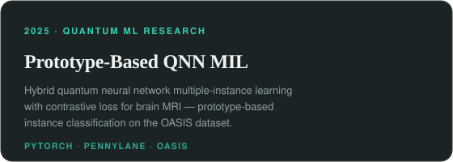
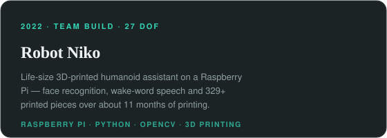
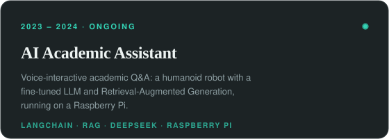
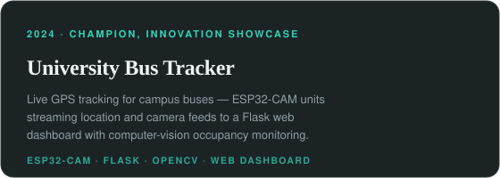
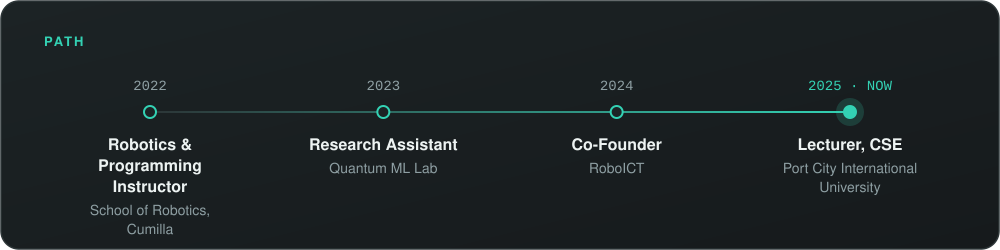

  
  
  
  
  
  
  
  

<table>
<tr>
<td width="33%" valign="top">

**Quantum ML security** 
Backdoor detection, explanation and repair in hybrid quantum neural networks — the subject of my M.Sc. thesis, QMedShield.

</td>
<td width="33%" valign="top">

**Explainable & medical AI** 
Interpretable models for high-stakes prediction: diabetes risk, industrial machinery failure, fake news, and medical imaging.

</td>
<td width="33%" valign="top">

**Robotics & IoT** 
A life-size 3D-printed humanoid, live campus bus tracking, and IoT devices for monitoring and energy harvesting.

</td>
</tr>
</table>

<!-- update each semester -->
## Now

- Building hybrid quantum–classical multiple-instance learning experiments for brain MRI → [ml_notebooks](https://github.com/tousifo/ml_notebooks)
- Writing up the Academic Assistant robot system — paper under review → [academic_assistant](https://github.com/tousifo/academic_assistant)
- Teaching CSE coursework at Port City International University — data structures, algorithms and AI/ML.

## Featured work

<table>
<tr>
<td width="50%" valign="top" align="center">

<b><a href="https://github.com/tousifo/ml_notebooks/blob/main/pimcl_new.ipynb">Prototype-Based QNN MIL</a></b> · <a href="https://github.com/tousifo/ml_notebooks/blob/main/pimcl_new.ipynb">Notebook</a>

</td>
<td width="50%" valign="top" align="center">

<b><a href="https://github.com/tousifo/Robot-Niko">Robot Niko</a></b> · <a href="https://github.com/tousifo/Robot-Niko">Code</a> · <a href="https://doi.org/10.5281/zenodo.23719561">Report</a> · <a href="https://youtu.be/6iEj3AY1AlA">Video</a>

</td>
</tr>
<tr>
<td width="50%" valign="top" align="center">

<b><a href="https://github.com/tousifo/academic_assistant">AI Academic Assistant</a></b> · <a href="https://github.com/tousifo/academic_assistant">Code</a>

</td>
<td width="50%" valign="top" align="center">

<b><a href="https://github.com/tousifo/University-Bus-Tracking-System">University Bus Tracker</a></b> · <a href="https://github.com/tousifo/University-Bus-Tracking-System">Code</a>

</td>
</tr>
</table>

## Research code

| Paper | Venue · Year | Code | Status |
|---|---|---|---|
| [Robot Niko — System Design and Build](https://doi.org/10.5281/zenodo.23719561) | Zenodo (report) · 2026 | [tousifo/Robot-Niko](https://github.com/tousifo/Robot-Niko) | published |
| Academic Assistant — RAG and Fine-Tuned LLMs | Manuscript · 2026 | [tousifo/academic_assistant](https://github.com/tousifo/academic_assistant) | under review |

Full publication list → [tousifo.github.io (Publications)](https://tousifo.github.io/#publications) · [Google Scholar](https://scholar.google.com/citations?user=N545a-3c6VUC&hl=en)

## Path

M.Sc. & B.Sc. Engineering in ICT, Comilla University · Full CV → [tousifo.github.io](https://tousifo.github.io/assets/documents/cv/Curriculum_Vitae_KM_Tousif_Bin_Parves_Public.pdf)

## Toolkit

| Area | Tools |
|---|---|
| Languages | Python, C++ |
| ML & vision | PyTorch, TensorFlow, scikit-learn, OpenCV |
| Quantum ML | PennyLane, Qiskit |
| LLMs & RAG | LangChain, fine-tuned LLMs |
| Robotics, IoT & deployment | ROS 2, Arduino, Raspberry Pi, Docker, Flask, Linux |

## Collaborate

I like hearing from students who want to get into quantum ML security or robotics, and from researchers who want to collaborate on backdoor defense in hybrid QNNs. Write to tousifbnn@gmail.com or open an issue on the repo you want to build on — [ml_notebooks](https://github.com/tousifo/ml_notebooks) and [Robot-Niko](https://github.com/tousifo/Robot-Niko) are the most active right now. I also supervise student projects at Port City International University.
